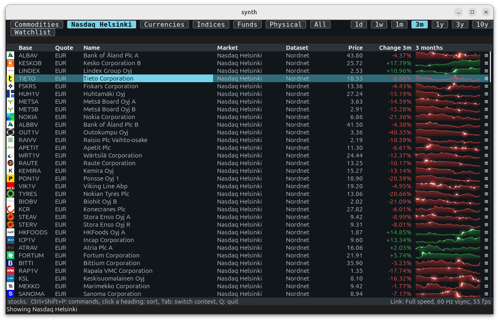

# stocks

A stock data browser for the terminal and a GTK window, built on
[cellui](https://github.com/rekola/cellui).

- **Markets**: a sortable table of shares, funds, indices, currencies and crypto, commodities and interest rates, with
  a price trace on each row. It stays fast with tens of thousands of rows.
- **Portfolios**: record buys and sells and see each position's value and P&L.
- **News**: headlines about instruments, markets and countries.
- **Charts** of any row over a period from a day to ten years.
- Works offline: the last prices are kept between runs.

## Build

    cmake -B build
    cmake --build build -j

You need CMake, a C++ compiler, libunistring (`libunistring-dev`) and, except on Windows, libcurl
(`libcurl4-openssl-dev`). The window needs GTK 4.10 or later; without it the program runs in the terminal only.
The other dependencies are fetched by CMake. To build against a local checkout of cellui, add
`-DFETCHCONTENT_SOURCE_DIR_CELLUI=/path/to/cellui`.

## Run

    build/stocks                      # default UI and data sources
    build/stocks --ui terminal        # or --ui window
    build/stocks --source synthetic   # made-up prices, no network
    build/stocks --market XHEL        # load only one market (repeatable)

Common keys:

| key | does |
|---|---|
| arrows, PgUp/PgDn, Home/End | move |
| `Tab`, `Shift+Tab` | switch between Markets, Portfolio and News |
| `]`, `[` | next / previous period (1d … 10y) |
| `c` or `Enter` on a trace | show the row as a large chart |
| `i` | everything known about the row |
| `M-x` (`Ctrl+Shift+P` in the desktop keymap) | command palette: every command, its description and key |
| `q` (`C-x C-c`, `Ctrl+Q`) | quit |

The mouse works too: click a heading to sort, a tag or row to choose it, a trace to chart it, and the ≡ button at
the end of a row for its menu (info, buy, sell, watchlist).

## Documentation

- [User guide](docs/guide.md): the contexts, portfolios, the watchlist, the data sources, all the command-line
  options and where data is kept.
- [Market-data server](docs/market-server.md): `market-ingest` and `market-server`, which load historical data
  into a database and serve it to the app.
- [Glossary](docs/glossary.md) of the project's terms.
- Design plans: [data model](plans/data-model.md), [portfolios](plans/portfolios.md),
  [server](plans/server.md), [calendars](plans/calendars.md), [quotes](plans/quotes.md),
  [embeddings](plans/embeddings.md).

## Tests

    cmake --build build -j
    ctest --test-dir build --output-on-failure

`stocks_tests` drives the browser on a test display (keys in, what it shows out); `market_tests` tests the
market-data server's stores. See the [user guide](docs/guide.md#tests) for running them against MariaDB.
